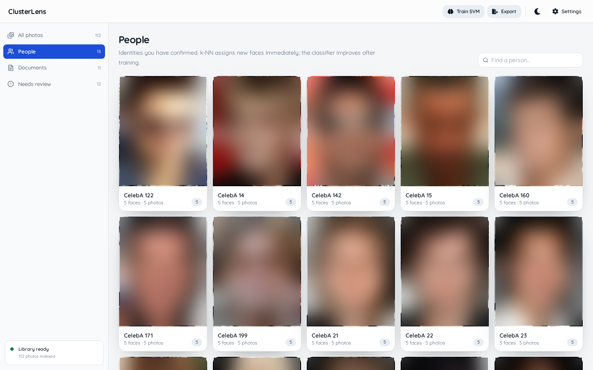
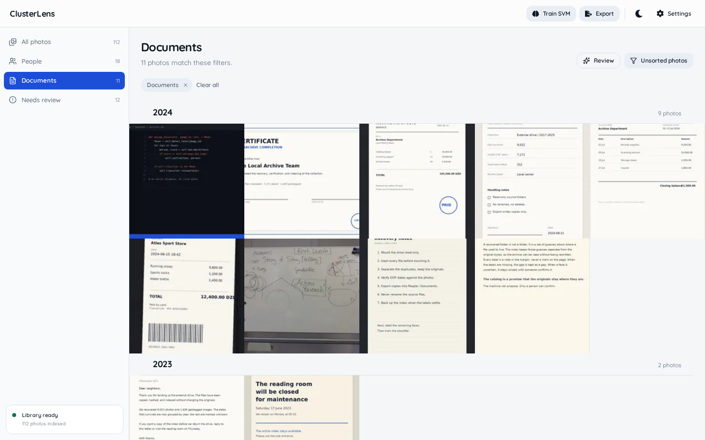

# ClusterLens

A local-first smart gallery for a recovered photo archive. It reads the EXIF that survived, reconstructs the people and documents from the pixels, and keeps every source folder read-only.



## What it does

- Indexes folders in place. A scan hashes files, links exact duplicates, and marks missing files without deleting metadata.
- Finds people with InsightFace and HDBSCAN proposals, then assigns new faces with k-NN and an optional linear SVM trained from corrections.
- Groups the gallery by EXIF year and labels documents and screenshots with zero-shot SigLIP prompts. People and Documents are the primary browse modes.
- Exports full-photo copies into `People/<name>/`, `People/Unsorted/`, `Documents/<type>/`, and `Unknown/`, with a manifest for every copy.
- Keeps indexing progress, failures, and job history in a bottom-left status dock, so the gallery stays edge-to-edge.



## Run it

Requires Python 3.10+, Node 20.19+ (or 22.12+), and about 2 GB of disk for the model weights.

```bash
git clone https://github.com/abderrahmenex86/ClusterLens.git
cd ClusterLens
python -m venv venv
source venv/bin/activate
pip install -r requirements.txt

cd frontend
npm install
npm run build
cd ..

python -m backend.app
```

Open [http://127.0.0.1:8765](http://127.0.0.1:8765) and add folders from Settings → Sources. The first analysis downloads the InsightFace and SigLIP weights once; later runs stay on the machine.

For development, run `npm run dev` in `frontend` with the API on port 8765. Vite proxies `/api`. Run the backend tests with:

```bash
venv/bin/python -m unittest discover -s tests
```

Set `CLUSTERLENS_DATA_DIR` to choose where SQLite, thumbnails, face crops, and classifier models live. The default is `~/.local/share/clusterlens`.

## How it works

A scan records file hashes and links exact duplicates to one image. A thumbnail job fills the grid first, then the analysis job extracts face boxes and 512-D embeddings, computes a SigLIP image embedding, and stores zero-shot scene labels.

Confirmed faces go through k-NN first. If a linear SVM is trained, its probability is a second opinion; uncertain faces stay in Unsorted. HDBSCAN proposes new people from that pool, and naming a proposal creates a person. A face moved away from a person becomes a cannot-link for that person, enough corrections queue a retrain, and clusters remain proposals rather than truth.

Export is a copy job, never a move. A photo with three confirmed people is copied into three folders. If it has no confirmed person, it falls through to Documents, then Unknown. Every copy is recorded in `.clusterlens/manifest.jsonl`.

## Constraints

Sources are read-only by contract. The indexer opens them read-only, duplicate detection groups instead of moving, and export writes only to a destination outside the sources.

The app binds to `127.0.0.1`, serves the frontend from the same origin, and has no upload path or CORS. Photos stay on disk. Model downloads are the only network calls, and only on the first run.

No vector database, cloud queue, or hosted demo. SQLite in WAL mode, two background workers, and locally cached models are enough for a personal archive.

## Limits

- First ingest is CPU-bound. On a 6-core Ryzen 5, face detection measured about 310 ms per image, and SigLIP added roughly 0.3 s per image. Expect one to two hours for 9,000 photos; incremental scans are fast.
- Dates come from EXIF when present. A scan of the recovered archive found 7,171 usable dates across 9,022 files, so 1,851 photos fall into Date unknown. GPS is present on 1,630 files but is not used.
- Zero-shot scene labels are approximate. People and documents with unusual framing can land in the wrong label, and there is no OCR pass.
- The folder watcher is not wired yet. Adding a source scans it; new files need a rescan.
- Manual face creation and a drag-and-drop box editor are not there. A selected face can be reassigned or corrected through numeric box coordinates, which re-embeds it.
- Semantic search exists in the API but is disabled in the UI for now.
- The interface is desktop-first. Mobile has a compact nav, not the full sidebar workflow.
- There is no authentication. That fits a localhost tool and not a shared machine.

## Preview data

The screenshots use a 112-photo toy library: five photos for each of twenty CelebA identities, plus eleven documents and one event ticket. Eighteen identities are confirmed and two remain as review proposals. The source images are not committed. CelebA is used locally under its non-commercial research terms, and the faces are blurred in the screenshots. The receipts, invoices, forms, notes, and ticket were generated for the demo; the whiteboard is a CC BY-SA photo. Dataset links, terms, and credits are in [docs/sample-data.md](docs/sample-data.md).

## Stack

FastAPI, SQLite, InsightFace, SigLIP, HDBSCAN, scikit-learn, React, TypeScript, Vite, Tailwind, Radix primitives.
