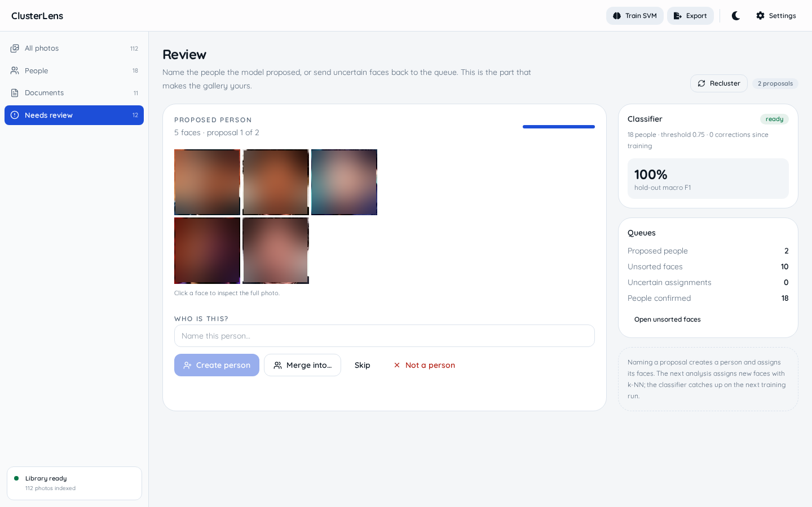
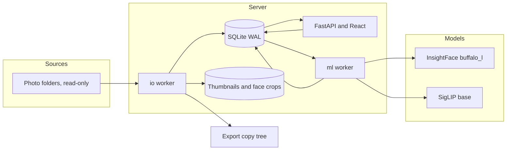

# ClusterLens

ClusterLens is a local-first gallery for a recovered photo archive. I built it for folders where the file names are gone, duplicates are common, and the surviving EXIF is often the only reliable date. It indexes folders in place, groups faces into people with InsightFace and HDBSCAN, labels documents and scenes with SigLIP, and exports a people-first copy. It runs as one FastAPI process with a React front end and a SQLite index. The source folders are opened read-only.


## Table of contents

- [Why this exists](#why-this-exists)
- [What stays on your machine](#what-stays-on-your-machine)
- [Requirements](#requirements)
- [Install and run](#install-and-run)
- [First run](#first-run)
- [Data directory](#data-directory)
- [Usage](#usage)
- [Configuration](#configuration)
- [How it works](#how-it-works)
- [Export and backup](#export-and-backup)
- [HTTP API](#http-api)
- [Testing](#testing)
- [Development](#development)
- [Troubleshooting](#troubleshooting)
- [Preview data](#preview-data)
- [Stack](#stack)
- [Limits](#limits)

## Why this exists

ClusterLens started with a recovered archive of 9,022 files. The archive had 7,171 usable EXIF dates, 1,630 files with GPS, and no reliable file names. I wanted the machine to propose people and document types without moving, renaming, or rewriting the originals. The review step exists because those proposals are guesses; the index records what I confirmed and leaves the source files alone.

## What stays on your machine

ClusterLens binds to `127.0.0.1:8765` by default. It has no authentication, no CORS configuration, and no upload endpoint. If you change `CLUSTERLENS_HOST`, you expose the API and the original-file endpoint to the network.

The scanner opens source folders read-only. It hashes new or changed files, writes an index, and never renames, moves, or deletes a source file. Removing a source from ClusterLens deletes its rows in the index, not the folder.

The app writes its database, thumbnails, face crops, and classifier pickles to `$CLUSTERLENS_DATA_DIR`, which defaults to `~/.local/share/clusterlens`. Source photos and exports stay wherever you put them.

| What | When | What is sent |
|---|---|---|
| InsightFace weights | first analyze | model name to the InsightFace download source |
| SigLIP weights | first analyze | model name to Hugging Face |
| Python and npm packages | setup | package names to PyPI and npm |
| Runtime | after setup | no telemetry, analytics, or update check is implemented |

No photo, face, or index data is sent with those requests.

## Requirements

- Python 3.10 or newer. The code uses `X | Y` annotations; I run 3.14.9 here.
- Node 20.19 or newer on the 20.x line, or 22.12 and later. Vite 8 sets that floor; I run 26.13.0 here.
- About 2 GB of free disk for the model caches and working room. On this machine the InsightFace cache is 326 MB and the SigLIP cache is 779 MB.
- A CPU. InsightFace runs through ONNX Runtime and SigLIP through PyTorch, both on CPU. There is no GPU path.
- Linux. I have not tested macOS or Windows. The folder picker shells out to `zenity`; the open-export action shells out to `xdg-open`.
- No database server, message broker, or external service.

## Install and run

```bash
git clone https://github.com/abderrahmenex86/ClusterLens.git
cd ClusterLens
python3 -m venv venv
source venv/bin/activate
python -m pip install --upgrade pip
pip install -r requirements.txt

cd frontend
npm install
npm run build
cd ..

python -m backend.app
```

Expected startup output:

```text
INFO:     Started server process [12345]
INFO:     Waiting for application startup.
INFO:     Application startup complete.
INFO:     Uvicorn running on http://127.0.0.1:8765 (Press CTRL+C to quit)
```

Check that the API is alive:

```bash
curl -s http://127.0.0.1:8765/api/health
```

```json
{"status":"ok","version":"2.0.0"}
```

Open [http://127.0.0.1:8765](http://127.0.0.1:8765). The front end is served from `frontend/dist`; if that directory is missing, the root page returns `Frontend build not found. Run the Vite dev server.` Build it with `cd frontend && npm run build`, or use the Vite dev server described under Development.

If `python3 -m venv` fails on Debian or Ubuntu, install the venv package first:

```bash
sudo apt install python3-venv
```

## First run

1. Open `/sources`, choose Add folders, paste one path per line or use Choose folders, leave Include subfolders on, then choose Add and index. The source row appears and a scan job starts in the activity dock.
2. The scan queues thumbnails and analysis. The gallery fills as previews appear. People stays at zero until you confirm a proposal, and Documents stays at zero until the analysis pass writes scene labels.
3. The first analysis downloads InsightFace buffalo_l (326 MB here) and SigLIP base (779 MB here). They are cached in `~/.insightface/models/buffalo_l` and the Hugging Face cache, normally `~/.cache/huggingface`. That download is the point where the app can look idle.
4. Expect the first pass to be CPU-bound. On a 6-core Ryzen 5 I measured about 310 ms per image for face detection and about 0.3 seconds per image for SigLIP. That works out to one to two hours for a 9,022-file archive. Later scans reuse thumbnails, faces, and embeddings.

The activity dock shows job status and the error count. `GET /api/jobs/{id}/items` returns the per-item errors as JSON.

## Data directory

The default layout is:

```text
~/.local/share/clusterlens/
  clusterlens.db
  clusterlens.db-wal
  clusterlens.db-shm
  thumbs/<image_id>/256.webp
  thumbs/<image_id>/1024.webp
  face-thumbs/<face_id>.webp
  models/classifier_<unix-timestamp>.pkl
```

| Path | Holds | If you delete it |
|---|---|---|
| `clusterlens.db` | index, settings, people, labels, jobs | You lose the index and labels; source photos are untouched |
| `clusterlens.db-wal`, `clusterlens.db-shm` | SQLite write-ahead log | Part of the database; do not delete these separately |
| `thumbs/<image_id>/256.webp`, `1024.webp` | gallery previews | Regenerated from the original on the next preview request |
| `face-thumbs/<face_id>.webp` | face crops | Regenerated by analyze or a box re-embed |
| `models/classifier_<timestamp>.pkl` | active SVM | Retrain to replace it |

InsightFace writes to `~/.insightface/models/buffalo_l`, and Transformers uses the Hugging Face cache, normally `~/.cache/huggingface`. Set `HF_HOME` if you want that cache somewhere else. Both caches can be deleted and downloaded again.

> **Destructive:** Reset library deletes the index, thumbnails, face crops, and classifier pickles. It leaves source photos and exported folders alone. Pause or cancel active jobs first.

The Settings page has the Reset library action. The API response includes `Index and caches cleared. Source files and exported folders were not touched.` If a job is active, the API returns `409` with `Pause or cancel active jobs before resetting`. With `keep_sources` on, sources stay and can be rescanned; with it off, the source rows are removed too. The reset also runs `VACUUM` on a best-effort basis.

To run two libraries side by side, give each one its own data directory and port. They do not share a database, thumbnails, or classifier:

```bash
CLUSTERLENS_DATA_DIR="$HOME/.local/share/clusterlens-personal" CLUSTERLENS_PORT=8765 venv/bin/python -m backend.app
CLUSTERLENS_DATA_DIR="$HOME/.local/share/clusterlens-demo" CLUSTERLENS_PORT=8766 venv/bin/python -m backend.app
```

## Usage

### 1. Add a source

Open `/sources` and choose Add folders. Paste one path per line, or use Choose folders to open a native picker. Include subfolders is on by default. Add and index queues a scan immediately.

A source cannot be the data directory, inside the data directory, or overlapping another source. The API rejects those cases before anything is scanned. Removing a source deletes its rows in `sources` and `files`; the folder and the original files stay on disk. The optional `forget` query on `DELETE /api/sources/{id}` also removes images that no longer have a file.

### 2. Browse by person and document

All photos is the unfiltered timeline. Known capture dates sort newest first, unknown dates go last, and more photos load as you scroll. People, Documents, and Needs review are the other sidebar entries. A URL can carry `person`, `scene`, `source`, `year`, `unsorted`, and `document`, which makes a filtered view bookmarkable.

Click a photo to open the overlay. Face boxes are clickable. From there you can assign a face to a person, create a person, move a face, mark it as not a face, open the numeric box editor, or find similar faces by cosine similarity. A box edit queues `reembed_face`, which re-runs detection and replaces the embedding only if the corrected box overlaps a detected face with IoU of at least 0.25.


_The Documents view uses the seven primary SigLIP labels and groups the demo's 11 documents by year._

### 3. Review proposals and faces



_Needs review shows the latest HDBSCAN proposals, the unsorted face count, and the active classifier. The demo leaves two proposals open so the flow has something to review._

For a proposal, type a name and choose Create person, or choose Merge into to move the proposal's faces into a person you already have. Skip moves to the next proposal; Not a person marks the whole proposal ignored. For an individual face, Review faces lets you assign it, create a person, or mark it as not a face.

The counts describe the queue. A proposal can be a false group, and a face can be a blurry background face that should be ignored. The review step turns the model's guesses into a small set of confirmed labels.

### 4. Train the classifier

Train SVM in the top bar queues `train_classifier`. The button is disabled until at least two people have two faces each. The classifier card on Review shows the active model's timestamp, class count, threshold, macro F1, and corrections since training. The Settings page has an Assign unsorted faces button that runs a fresh k-NN and SVM pass over the current unsorted queue.

A small library can put near-identical shots on both sides of the hold-out, so read the first number as a check that training ran. The Limits section has the longer version.

### 5. Export the library

Open `/export`, set a destination, choose Preview export, then Start export. The default destination is `~/Pictures/ClusterLens Export`. The preview does not write photos; it validates the destination and counts what would be copied. The routing rules, destination checks, and manifest format are in [Export and backup](#export-and-backup).

## Configuration

### Environment variables

Backend variables are read at startup by `backend/config.py`. The Hugging Face flags are set by `backend/ml.py`, and `VITE_API_TARGET` is read by Vite.

| Variable | Required | Default | What it does |
|---|---|---|---|
| `CLUSTERLENS_DATA_DIR` | no | `~/.local/share/clusterlens` | Where the SQLite database, thumbnails, face crops, and classifier pickles live |
| `CLUSTERLENS_HOST` | no | `127.0.0.1` | Bind address; changing it exposes an unauthenticated API to the network |
| `CLUSTERLENS_PORT` | no | `8765` | HTTP port for the API and the built front end |
| `CLUSTERLENS_IMAGE_MODEL` | no | `google/siglip-base-patch16-224` | Hugging Face model for image and text embeddings and scene labels; existing images are not re-embedded or relabelled just because this changes |
| `CLUSTERLENS_IMAGE_MODEL_DIM` | no | `768` | Reported by `GET /api/system/info`; the model's output dimension is what gets stored |
| `CLUSTERLENS_EMBEDDINGS` | no | `true` | Set to `false` to skip SigLIP image embeddings on new images; those images get no scene labels or search vectors |
| `CLUSTERLENS_SCENES` | no | `true` | Read into the settings object but not consulted by the analyze job; use the `scenes_enabled` setting instead |
| `CLUSTERLENS_ML_THREADS` | no | `6` | PyTorch CPU threads for SigLIP; it does not cap ONNX Runtime or the rest of the process |
| `VITE_API_TARGET` | no | `http://127.0.0.1:8765` | Vite dev server proxy target, used only by `npm run dev` |
| `HF_HUB_DISABLE_IMPLICIT_TOKEN` | no | `1` if unset | Prevents an expired Hugging Face token from turning a public model download into a 401 |
| `HF_HUB_DISABLE_TELEMETRY` | no | `1` if unset | Disables Hugging Face telemetry |

The analyzer selects images with a missing `faces_at`, `embed_at`, or `scene_at` timestamp. Changing `CLUSTERLENS_IMAGE_MODEL` does not clear those timestamps, so a full re-embed needs a reset or a manual SQLite update.

Example with an explicit data directory and a different port:

```bash
CLUSTERLENS_DATA_DIR="$HOME/.local/share/clusterlens-demo" \
CLUSTERLENS_PORT=8766 \
venv/bin/python -m backend.app
```

### Stored settings

These live in the `settings` table and can be changed from Settings or `PATCH /api/settings`. The API accepts a JSON object with a `values` key.

| Key | Default | What it does |
|---|---:|---|
| `auto_retrain_after` | 50 | Queue a classifier retrain after this many corrections since the active model was trained; `0` or a negative value disables automatic training |
| `classifier_threshold` | 0.75 | SVM probability required before the classifier can assign a face |
| `cluster_min_size` | 4 | Minimum faces in an HDBSCAN proposal; also the unsorted count that triggers clustering after an analyze or assign pass |
| `cluster_min_samples` | 3 | HDBSCAN minimum samples; higher values produce stricter clusters and more noise |
| `face_min_det_score` | 0.6 | InsightFace detector confidence required to keep a face |
| `face_min_size` | 48 | Minimum face side in pixels for detection and clustering; also the quality floor when clustering |
| `knn_high` | 0.50 | Cosine similarity at or above which k-NN assigns a face directly |
| `knn_low` | 0.35 | Below this score, a confident SVM can override the k-NN winner; between `knn_low` and `knn_high`, the SVM can only confirm the same person |
| `scenes_enabled` | 1 | Run SigLIP scene labeling and document classification; the Settings page exposes this as a switch |
| `watcher_enabled` | 0 | Stored only; the folder watcher is not implemented in 2.0 |
| `embedding_model` | `google/siglip-base-patch16-224` | Stored only; the actual image model comes from `CLUSTERLENS_IMAGE_MODEL` |

The backend reads these at the start of the relevant job or correction. A saved change takes effect on the next run without a restart. `PATCH /api/settings` ignores keys outside the allowlist and returns the full settings object after the update.

## How it works

One FastAPI process serves the API and the built React app. Two worker threads handle SQLite-backed jobs: the `io` queue runs scan, thumbnail, and export jobs; the `ml` queue runs analyze, assign, cluster, train, and face re-embedding. Each queue has one worker, so ML jobs run one at a time.



### Scan

`backend/services.py:handle_scan` walks each enabled source with `os.walk`, does not follow symlinks, and skips hidden entries plus a small deny list (`node_modules`, `.git`, `venv`, `@eaDir`, and similar). Supported extensions are `.jpg`, `.jpeg`, `.png`, `.webp`, `.heic`, `.heif`, `.bmp`, `.tif`, and `.tiff`. A file whose size and `mtime_ns` match the last scan and already has an image is reused without hashing. New or changed files get a SHA-256 hash, which links byte-identical copies to one `images` row. Unseen files are marked missing without losing their metadata.

### Thumbnails and dates

`backend/ml.py:load_image_asset` handles EXIF orientation, reads `DateTimeOriginal`, `DateTimeDigitized`, or `DateTime`, and falls back to no date. It does not fall back to the filesystem modification time. The date source is stored as `exif` or `unknown`. `save_thumbnails` writes `256.webp` and `1024.webp` with quality 82; `save_face_crop` writes a padded 256 px WebP per face.

### Faces and scene labels

`backend/services.py:handle_analyze` runs InsightFace `buffalo_l` on CPU with a 640 by 640 detector. Faces smaller than `face_min_size` (48 px by default) or below `face_min_det_score` (0.6 by default) are discarded. Each remaining face gets a normalized 512-D embedding and a quality value equal to its smaller side in pixels.

The same pass stores a SigLIP image embedding when `CLUSTERLENS_EMBEDDINGS` is on. Scene labels come from 49 text prompts. The model stores the top five labels with scores at or above 0.02 and marks a primary label only when the top score is at least 0.03. The seven document labels are `document`, `screenshot`, `receipt`, `whiteboard`, `paper`, `book`, and `form`.

### Assign and cluster

`backend/services.py:handle_assign` compares each unsorted face against every confirmed face. The best cosine score per person wins. A score at or above `knn_high` (0.50) assigns the face by k-NN. Below that, the SVM is consulted: its probability must be at least `classifier_threshold` (0.75), the person must be in the k-NN candidate set, and either the k-NN score is below `knn_low` (0.35) or the SVM agrees with the k-NN winner. A face moved away from a person is blocked from being reassigned to that same person by the next pass.

`backend/services.py:handle_cluster` runs HDBSCAN with cosine distance, `cluster_selection_method="eom"`, `cluster_min_size` (4), and `cluster_min_samples` (3) over unsorted faces whose quality is at least `face_min_size`. A run is stored in `cluster_runs`, and each group becomes a row in `clusters`. Accepting a proposal creates a person or merges into an existing one. Only the latest run appears in the review queue.

### Train

Training uses a linear SVM with `probability=True`, `class_weight="balanced"`, and `C=1.0`. It takes at most 200 faces per person. If there are at least two people with two faces each and enough samples for a stratified split, it holds out 20% with `random_state=1337` and records macro F1 and accuracy. Otherwise it trains on everything and leaves the metrics empty. The active model is a pickle in the data directory, and `GET /api/classifier` reports its timestamp, class count, threshold, macro F1, and corrections since training.

### Jobs

The job queue is in `backend/jobs.py`. A worker claims the oldest queued job in its queue by priority and creation time, writes a heartbeat every 10 seconds, and checks pause and cancel flags between items. A failed job is requeued until `attempts` reaches `max_attempts` (3). On startup, `recover_stale_jobs` requeues a running job whose heartbeat is older than 120 seconds; after three attempts it becomes `failed` with `Interrupted`.

### Database

| Table | Holds |
|---|---|
| `images` | one row per content hash |
| `files` | one row per source path, with missing state |
| `faces` | normalized embeddings, bounding boxes, assignment source and confidence |
| `people` | confirmed names |
| `clusters` | HDBSCAN proposals per run |
| `scene_labels` | top SigLIP labels and scores |
| `classifier_runs` | active SVM path, classes, metrics, threshold |
| `jobs`, `job_errors` | queue state, progress, and per-item errors |
| `exports`, `export_items` | export status, manifest path, copied files |

`face_corrections` is an append-only log of label changes, box edits, cluster accepts, and undos.

### Project layout

| Path | What it is |
|---|---|
| `backend/app.py` | FastAPI lifespan, worker startup, SPA fallback |
| `backend/api.py` | all `/api` routes, request models, response shaping |
| `backend/services.py` | scan, analyze, assign, cluster, train, export |
| `backend/jobs.py` | SQLite job queue, workers, pause/cancel/retry |
| `backend/ml.py` | InsightFace, SigLIP, EXIF, thumbnails, face crops |
| `backend/db.py` | schema, default settings, WAL connection |
| `backend/config.py` | environment variables and data directory paths |
| `frontend/src/App.tsx` | routes and app bootstrap |
| `frontend/src/pages/` | gallery, people, review, sources, export, settings |
| `frontend/src/lib/api.ts` | typed API client and SSE handling |
| `frontend/src/components/` | layout, shared UI, face context dialog |
| `tests/test_core.py` | backend unit and integration tests |
| `docs/sample-data.md` | preview dataset and licensing notes |
| `docs/screenshots/` | README images |

## Export and backup

`export_preview` walks every image with at least one live file and decides a branch in this order:

1. One or more confirmed people: `People/<name>/`, one copy per person.
2. No confirmed person, but at least one visible face: `People/Unsorted/`.
3. No face, but a primary document label: `Documents/<label>/`.
4. Everything else: `Unknown/`.

The preview and the job apply the same routing rules. `handle_export` copies the canonical original (the largest live file for that image), keeps the original basename, and appends `__<hash8>` when a relative path already exists. It writes each copy to a `.tmp` file and uses `os.replace` to make the final name appear atomically. The destination gets a `.clusterlens/export.json` marker and a `.clusterlens/manifest.jsonl` manifest with the image id, export path, label, person id, content hash, date, source paths, and byte size.

The destination must be empty, not exist yet, or be a previous ClusterLens export with `.clusterlens/export.json`. It cannot be inside a source or the app data directory. If a photo has multiple confirmed people, the preview warns and the job copies it once per person. Filename collisions get a short content-hash suffix. A destination with existing files needs the ClusterLens marker. Without it, the API returns `Destination is not empty and was not created by ClusterLens`.

Example from the 112-photo preview library:

```bash
curl -s -X POST http://127.0.0.1:8766/api/exports/preview \
  -H 'Content-Type: application/json' \
  -d '{"destination":"/tmp/clusterlens-export"}' | python3 -m json.tool
```

```json
{
  "destination": "/tmp/clusterlens-export",
  "totalPhotos": 112,
  "copies": 112,
  "bytes": 2682584,
  "byBranch": {
    "people": 90,
    "peopleUnsorted": 10,
    "documents": 11,
    "unknown": 1
  },
  "multiPersonPhotos": 0,
  "collisions": 0,
  "freeSpace": 7159730176,
  "warnings": []
}
```

The one `unknown` photo in that library is an event ticket. SigLIP labels its primary scene as `night`, so it is not in Documents and has no face. It shows the zero-shot limit in practice.

The export only adds files to the destination. It leaves the originals and the index untouched, and it does not delete files from an earlier export. To back up the index, stop the app and copy the data directory:

```bash
backup="$HOME/backups/clusterlens-$(date +%Y%m%d)"
mkdir -p "$backup"
cp -a "$HOME/.local/share/clusterlens/." "$backup/"
```

Copying a live WAL database can miss the latest writes, so stop the app first. Source photos and exports are separate; back them up with your normal file backup. A backup of the index preserves people, corrections, scene labels, classifier runs, and job history. It does not preserve the source photos or the exported copies.

## HTTP API

All routes are under `/api`. FastAPI's interactive documentation is at `/docs`, and the schema is at `/openapi.json`. Errors use the standard shape:

```json
{"detail": "Not a directory: /home/me/Photos-missing"}
```

| Area | Routes |
|---|---|
| System | `GET /api/health`, `GET /api/system/info`, `POST /api/system/reset`, `POST /api/system/pick-folders`, `GET /api/system/browse`, `POST /api/system/open-folder`, `GET /api/models` |
| Settings | `GET /api/settings`, `PATCH /api/settings` |
| Sources | `GET/POST /api/sources`, `PATCH/DELETE /api/sources/{id}`, `POST /api/sources/{id}/scan`, `POST /api/sources/{id}/relink` |
| Jobs | `GET /api/jobs`, `POST /api/jobs/analyze`, `POST /api/jobs/assign`, `GET /api/jobs/{id}`, `GET /api/jobs/{id}/items`, `POST /api/jobs/{id}/pause`, `POST /api/jobs/{id}/resume`, `POST /api/jobs/{id}/cancel`, `POST /api/jobs/{id}/retry` |
| Images | `GET /api/images`, `GET /api/images/{id}`, `GET /api/images/{id}/preview`, `GET /api/images/{id}/file`, `GET /api/images/{id}/similar`, `POST /api/images/{id}/faces` |
| Search and labels | `GET /api/search`, `GET /api/scenes`, `GET /api/timeline`, `GET /api/stats` |
| People | `GET/POST /api/people`, `GET/PATCH/DELETE /api/people/{id}`, `POST /api/people/merge`, `POST /api/people/{id}/split`, `GET /api/people/{id}/faces` |
| Faces | `PATCH /api/faces/{id}`, `POST /api/faces/bulk`, `GET /api/faces/{id}/similar`, `POST /api/corrections/{id}/undo` |
| Clusters | `GET /api/clusters`, `POST /api/clusters/recluster`, `POST /api/clusters/{id}/accept`, `POST /api/clusters/{id}/ignore` |
| Review | `GET /api/review`, `GET /api/review/faces` |
| Classifier | `GET /api/classifier`, `GET /api/classifier/runs`, `POST /api/classifier/train` |
| Exports | `POST /api/exports/preview`, `POST /api/exports`, `GET /api/exports`, `GET /api/exports/{id}`, `POST /api/exports/{id}/cancel`, `POST /api/exports/{id}/open` |
| Events | `GET /api/stream` (server-sent events for job and source state) |

`GET /api/images` accepts `person_id`, `scene`, `source_id`, `year`, `has_faces`, `unsorted`, `document`, `limit` (1 to 200), and `offset`. `GET /api/search` accepts `q`, `person_id`, `scene`, `source_id`, `year`, `document`, `limit` (1 to 100), and `offset`, and returns 409 with `Image embeddings are not ready yet` until the embedding pass has produced vectors.

`POST /api/images/{id}/faces` currently returns 501 with `Manual face creation will arrive in the next iteration`. The UI creates faces through detection and edits their boxes through `PATCH /api/faces/{id}`.

## Testing

Run the backend suite from the repository root:

```bash
venv/bin/python -m unittest discover -s tests
```

Expected output:

```text
.......
----------------------------------------------------------------------
Ran 7 tests in 1.028s

OK
```

The tests cover the stratified split helper, people-first export routing with multi-person copies, ignored faces staying out of person views, rejecting an export inside a source, nested source validation, a scan that does not modify source files, and thumbnail generation.

They do not test model accuracy, the browser UI, or a real archive. Those are the parts you have to check by running the app against your own folder.

Check the front end from `frontend/`:

```bash
npm run typecheck
npm run build
```

`typecheck` prints nothing on success. The current build ends with:

```text
dist/assets/index-CgiOeBNt.js   555.76 kB │ gzip: 167.12 kB
✓ built in 507ms
```

Vite prints a warning that the main chunk is larger than 500 kB. The build still succeeds.

## Development

Run the API on 8765 and Vite on 5181 in two terminals:

```bash
source venv/bin/activate
python -m backend.app
```

```bash
cd frontend
npm run dev
```

Vite proxies `/api` to `http://127.0.0.1:8765`. If the backend is on another port, set the target before starting Vite:

```bash
VITE_API_TARGET=http://127.0.0.1:8766 npm run dev
```

The backend starts Uvicorn with `reload=False`. Restart the process after changing Python code. The front end hot-reloads through Vite.

Useful checks before a change:

```bash
venv/bin/python -m unittest discover -s tests
cd frontend && npm run typecheck && npm run build
```

`npm run lint` also exists and passes on this tree. `npm run preview` serves the built `frontend/dist` through Vite; the FastAPI app already serves that build at the app root, so it is only useful for checking the static bundle in isolation.

Issues and pull requests are welcome. Run the backend tests, `npm run typecheck`, and `npm run build` before sending a change. Keep source handling read-only, and do not add a path that writes into a source or into the app data directory.

## Troubleshooting

### The app opens an empty library

The default data directory is `~/.local/share/clusterlens`. If your index is somewhere else, start the app with `CLUSTERLENS_DATA_DIR` pointing at the directory that contains `clusterlens.db`. Two libraries on one machine need different data directories and different ports.

### `Frontend build not found. Run the Vite dev server.`

`frontend/dist` is missing. Run `cd frontend && npm run build`, or start `npm run dev` and use the Vite URL. The API alone is running, but it has no SPA to serve.

### `Not a directory: /path`

The source path does not exist, is a file, or was typed with a shell shortcut that the server did not expand. Use an absolute path. The API expands `~`, but it does not expand environment variables.

### `Folder is already a source: /path`

That exact folder is already in the source list. Use Rescan to refresh it.

### `Folder is inside an existing source: /path` or `Folder contains an existing source: /path`

Sources cannot overlap. Add the parent folder once and let it scan recursively, or remove the overlapping source first. Overlapping sources would index the same files twice and inflate the library.

### Source status is `offline` and the job says `Source folder is not available: /path`

The drive is unmounted, the folder was moved, or the path changed. Remount it, or relink the source:

```bash
curl -s -X POST http://127.0.0.1:8765/api/sources/1/relink \
  -H 'Content-Type: application/json' \
  -d '{"path":"/new/path/to/photos"}'
```

Relinking queues a fresh scan. If the new path is not a directory, the API returns `422` with `New path is not a directory`.

### `Export destination cannot be inside a source folder`

The export would write into a folder ClusterLens is indexing, which would make the export part of the source on the next scan. Choose a folder outside every source, for example `~/Pictures/ClusterLens Export` when the sources are under `~/Pictures/DCIM`.

### `Destination is not empty and was not created by ClusterLens`

ClusterLens only writes into an empty folder or a folder with its own `.clusterlens/export.json` marker. Pick an empty folder, or remove the old contents yourself. It will not merge into an arbitrary folder.

### `An export is already running`

The API allows one export job at a time. Wait for the current job, or cancel it from the Export page or `POST /api/exports/{id}/cancel`, then start the new one.

### `No confirmed faces to train on` or `Need at least two people with two faces each`

The SVM needs labels before it can learn. Confirm at least two faces for one person and two for another, then train again. A person with one face is still useful for k-NN, but it is not enough to train a classifier.

### `Image embeddings are not ready yet`

`GET /api/search` needs at least one image embedding. Wait for the analyze job to finish, or check whether `CLUSTERLENS_EMBEDDINGS` is set to `false`. The UI does not expose semantic search yet; this is an API-only feature in 2.0.

### `Native folder picker is not available. Install zenity or type a path.`

The Choose folders button calls `zenity`. Install it with your package manager, or paste the path into the text area. The text path is the portable option and works without a desktop environment.

### `Pause or cancel active jobs before resetting`

Reset refuses to run while a job is queued, running, or paused. Open the activity dock and pause or cancel the job, then reset. This guard exists because deleting the index under a running worker produces confusing partial state.

### `database is locked`

Another process is writing to the same SQLite file. Stop the other ClusterLens instance, or give each instance its own `CLUSTERLENS_DATA_DIR`. The connection uses WAL, a 5 second busy timeout, and `synchronous=NORMAL`; it is not designed for two writers on one database.

### Port 8765 is already in use

Start the second instance on another port:

```bash
CLUSTERLENS_PORT=8766 venv/bin/python -m backend.app
```

The health check and UI then live on `http://127.0.0.1:8766`.

## Preview data

The screenshots use a 112-photo toy library: five photos for each of 20 CelebA identities, plus 11 synthetic documents and one event ticket. The library has 100 detected faces, 18 confirmed people, 10 unsorted faces, two open proposals, 11 documents, and one source. The two proposals are `CelebA 17` and `CelebA 220`; they are left untouched so the review flow has something to show.

The 112-photo demo uses 8.6 MB in its data directory: 2.1 MB of thumbnails and 756 KB of face crops. That is a small sample, but it gives you a rough sense of the cache growth before you point the app at a full archive.

The classifier was trained on the 18 confirmed identities (90 faces) and reports macro F1 1.0 on a random 20% hold-out of 18 faces. With five photos per identity, that split is easy. The number verifies that training, metrics, and model persistence work; it only measures the pipeline.

```bash
curl -s http://127.0.0.1:8766/api/stats | python3 -m json.tool
```

```json
{
  "images": 112,
  "visibleImages": 112,
  "pendingImages": 0,
  "faces": 100,
  "people": 18,
  "unsortedFaces": 10,
  "scenes": 25,
  "documents": 11,
  "sources": 1,
  "proposals": 2
}
```

`visibleImages` counts images with a thumbnail. `images` also includes images whose thumbnail failed, which is why the two numbers can differ during a run.

The source images are not committed. CelebA is used locally under its non-commercial research terms, the identity labels are numeric, and the faces are blurred in every committed screenshot. The receipts, invoices, forms, notes, ticket, and code screenshot are synthetic images generated for the demo. The whiteboard is a CC BY-SA photo by Birkenkrahe. Dataset links, terms, and credits are in [docs/sample-data.md](docs/sample-data.md).

The screenshots were taken at 1440 by 900 in light mode. The app's default theme is light; the dark theme is a toggle in the top bar.

## Stack

| Layer | Choice |
|---|---|
| API | Python 3.10+, FastAPI 0.136 |
| Index | SQLite in WAL mode |
| Faces | InsightFace buffalo_l through ONNX Runtime |
| Image and text embeddings | SigLIP base through PyTorch and Transformers |
| Clustering and classifier | scikit-learn 1.8 (HDBSCAN and a linear SVM) |
| Front end | React 19.2, TypeScript 5.9, Vite 8.0, Tailwind 4.2 |
| UI primitives | Radix |

I picked SQLite because the whole index fits on one machine and the app has no second writer. There is no vector database, cloud queue, or hosted demo.

## Limits

First ingest is CPU-bound. On a 6-core Ryzen 5, face detection measured about 310 ms per image and SigLIP added roughly 0.3 seconds per image. A 9,022-file archive therefore takes one to two hours for the first full analysis. Incremental scans are much faster because unchanged files are skipped by size and mtime, and because thumbnails, faces, and embeddings are reused.

Dates come only from EXIF. In the recovered archive, 7,171 of 9,022 files had a usable date, so 1,851 photos fell into the unknown group. GPS was present on 1,630 files but is not read or displayed. A file with no EXIF date is not dated from its mtime or its folder name.

Scene labels are zero-shot guesses from SigLIP, not OCR or object detection. The model has 49 prompts covering places, objects, events, and document types. It stores the top five labels with scores at or above 0.02, and only marks a primary label when the top score is at least 0.03. A document photographed at a strange angle, a receipt in low light, or a ticket with a strong `night` signal can land outside the seven document labels. The preview library has exactly that case: an event ticket is labelled `night` and goes to `Unknown` on export.

Faces smaller than `face_min_size`, below `face_min_det_score`, in profile, or partly hidden may never reach the unsorted pool, so HDBSCAN never sees them. It can split one person across two proposals or merge two people into one. The review queue exists because those are normal failure modes.

The classifier's reported macro F1 is optimistic when there are only a few photos per person, because a random split can put near-duplicate shots on both sides. Treat the number as a way to notice broken training, not as a promise about your archive.

The folder watcher is not wired. `watcher_enabled` is stored, but no watchdog observer is started. New files need a rescan. Manual face creation returns 501. The box editor uses numeric coordinates; there is no drag handle. Person-to-person merge and split exist in the API but are not exposed as buttons; the review flow only merges a proposal into an existing person. Semantic search exists in the API but has no UI. There is no OCR, no video, no RAW support, and no undo button for corrections, although `POST /api/corrections/{id}/undo` exists.

The interface is desktop-first. A compact mobile nav exists, but the full sidebar workflow, the face overlay, and the export page are designed for a wide screen. There is no authentication. The default bind address is `127.0.0.1`, which fits a localhost tool; do not change `CLUSTERLENS_HOST` on a shared or untrusted network without putting your own access control in front of it.

The schema is created with `CREATE TABLE IF NOT EXISTS` and there is no migration framework. A schema change can require a fresh data directory or a manual SQLite migration. SQLite is also a single-writer design: one machine, one library, two worker threads. It is not a multi-user server and it is not a replacement for a cloud photo service.

The scanner skips symlinks and hidden entries. Network mounts and case-insensitive filesystems are untested. The database, thumbnails, and face crops are plain files; they are not encrypted. The repository has no project license file yet, so the code is not licensed for reuse.
