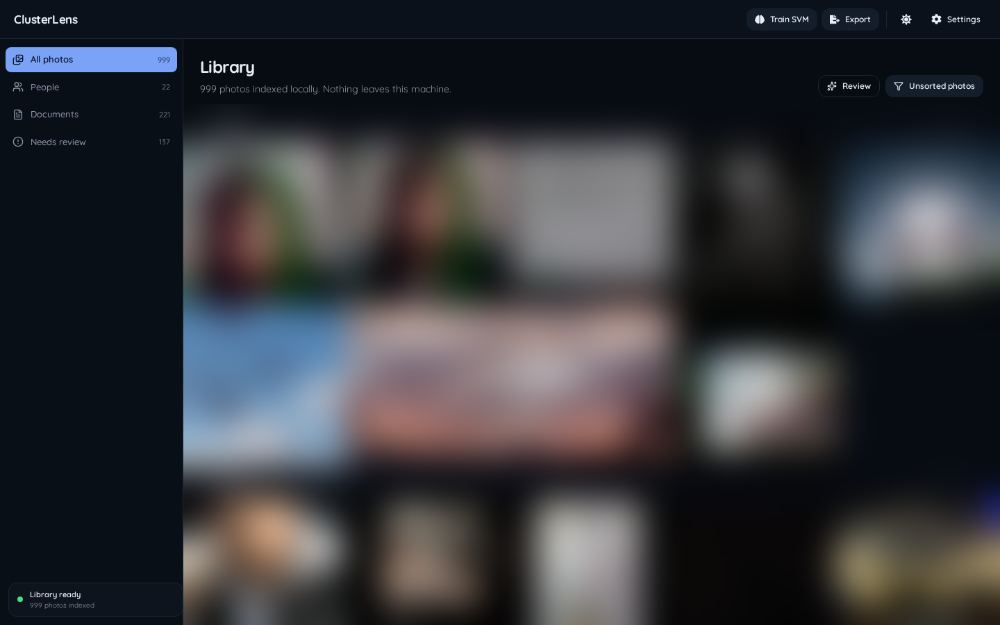

# ClusterLens

A local-first smart gallery for recovered photo archives. It was built after a corrupted drive left thousands of photos with scrambled filenames and partial metadata, so it keeps the EXIF that survived and reconstructs what is missing from the pixels: the people in the photos, the documents between them, and a timeline that still makes sense.



## What it does

- Indexes multiple folders in place. DCIM, Downloads, Pictures, Telegram, and Messenger folders are sources, not a special import format. Files are never moved, renamed, or deleted.
- Detects faces with InsightFace, groups unsorted faces with HDBSCAN, and keeps confirmed people stable while new photos arrive.
- Assigns new faces with k-NN over confirmed faces and an optional linear SVM trained from corrections.
- Groups the gallery by year from EXIF dates instead of rebuilding a Years folder. Photos without a usable date fall into one Date unknown group.
- Keeps indexing progress, failures, and job history in a floating bottom-left status dock, so the gallery stays edge-to-edge.
- Uses zero-shot labels to identify documents and screenshots without a separate classifier. People and Documents are the primary browse modes.
- Exports full-photo copies into a people-first tree, with documents and unknown as fallbacks. Every copy is recorded in `.clusterlens/manifest.jsonl`.
- Resets the index, thumbnails, classifier models, and export history from Settings without touching the source folders or exported copies.

## Run it

Requires Python 3.10+, Node 20.19+ (or 22.12+), and about 2 GB of disk for model weights.

```bash
git clone https://github.com/abderrahmenex86/ClusterLens.git
cd ClusterLens
python -m venv venv
source venv/bin/activate
pip install -r requirements.txt

cd frontend
npm install
npm run build
cd ..

python -m backend.app
```

Open [http://127.0.0.1:8765](http://127.0.0.1:8765). Add folders from Settings → Sources. The first analysis downloads the InsightFace and SigLIP weights once, then runs entirely on the machine.

For development, run `npm run dev` in `frontend` with the API on port 8765. Vite proxies `/api` to the backend. Run the backend tests with `venv/bin/python -m unittest discover -s tests`.

Set `CLUSTERLENS_DATA_DIR` to choose where the SQLite database, thumbnails, face crops, and classifier models live. The default is `~/.local/share/clusterlens`.

## How it works

Adding a source queues a background scan. The scanner hashes files, links exact duplicates to one image, and marks missing files without deleting their metadata. A separate IO job generates thumbnails first, so the gallery fills before the slower analysis. The analysis job then extracts face boxes and 512-D embeddings, computes a SigLIP image embedding, and stores zero-shot scene labels.

New faces first go through k-NN against confirmed faces. If a classifier is trained, its probability is used as a second opinion; uncertain faces stay in Unsorted. HDBSCAN proposes new people from that pool, and naming a proposal is what creates a person. Clusters are proposals, not truth; faces that never cluster go to a separate face-level review queue. Corrections are logged, a face moved away from a person becomes a cannot-link for that person, and enough corrections queue a classifier retrain.

SigLIP embeddings also power natural-language search in the API. The interface keeps search out of the way for now: People, Documents, and the timeline are the primary ways in. The same embeddings group visually similar photos without a vector database; at this library size, a matrix multiply is enough.

Export is a copy job, never a move. A photo with three confirmed people is copied into three `People/<name>/` folders. If it has no confirmed person, it falls through to `Documents/`, then `Unknown/`. The manifest records the source path, content hash, labels, and export path for every copy.

## Constraints

Sources are read-only by contract. The indexer opens them read-only, duplicate detection groups instead of moving, and export writes only to a chosen destination outside the sources. The old CLI that moved duplicates and archived originals is gone.

The app binds to `127.0.0.1`, serves the frontend from the same origin, and has no CORS or upload path. Photos stay on the machine. Model downloads are the only network calls, and only on the first run.

No vector database, no cloud queue, no hosted demo. SQLite in WAL mode, two background workers, and models cached locally are enough for a personal archive.

## Limits

- First ingest is CPU-bound. On a 6-core Ryzen 5, face detection measured about 310 ms per image; SigLIP adds roughly 0.3 s per image. Expect one to two hours for 9,000 photos. Incremental scans are fast.
- Dates come from EXIF when present. A scan of the recovered archive found 7,171 of 9,022 files with a usable EXIF date, so the gallery groups by year and the person timelines use real dates. The other 1,851 files show unknown rather than an inferred date; recovered file mtimes are treated as unreliable. GPS is present on 1,630 files but is not used yet.
- The folder watcher is not wired yet. Adding a source scans it; new files need a rescan until the watcher lands.
- Manual face creation and a drag-and-drop box editor are not there yet. A selected face can be reassigned, ignored, or corrected through numeric box coordinates, which re-embeds the face.
- The interface is desktop-first. Mobile has a compact nav, not the full two-sidebar workflow.
- There is no authentication. That is appropriate for a localhost tool and not for a shared machine.

## Stack

FastAPI, SQLite, InsightFace, SigLIP, HDBSCAN, scikit-learn, React, TypeScript, Vite, Tailwind, Radix primitives.
